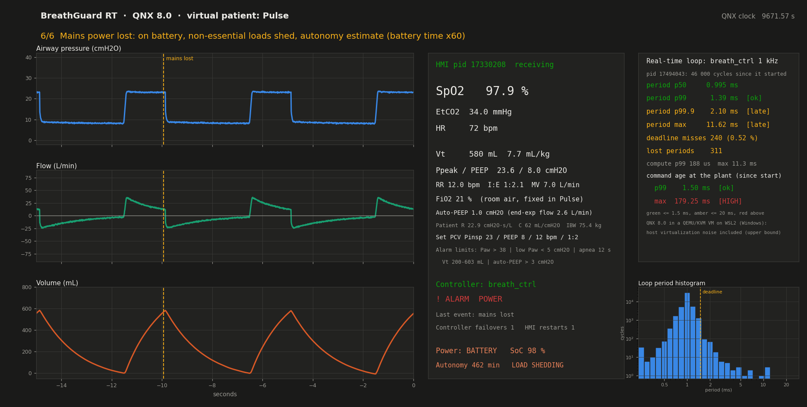
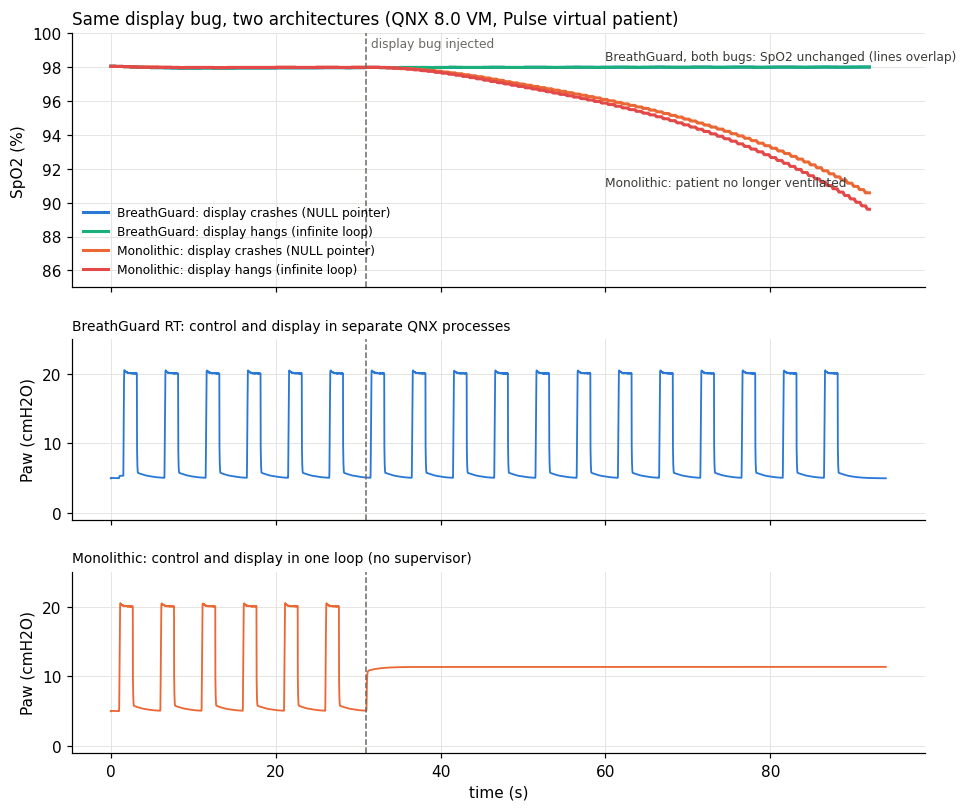

# BreathGuard RT

**An open-source reference architecture for a low-cost mechanical ventilator controller on QNX 8.0,
tested in closed loop against a virtual patient (Pulse Physiology Engine).**

Built for the QNX Everywhere hackathon (Robotics & Medical).

> **Not a medical device.** BreathGuard RT is not certified and must not be used on people. Its architecture is
> inspired by the principles of IEC 62304 and ISO 80601-2-12, without claiming compliance.

## The problem

Many open-source and low-cost ventilators (for example, those built during the pandemic) run everything in a
single program on a microcontroller. A bug in the display code can freeze the breathing control. Without a safety
architecture, these designs cannot reach clinical use.

## The idea

Split the ventilator into isolated QNX processes with real-time priorities. Breathing control and safety
**never** depend on the user interface, telemetry or the patient model. When something fails, the kernel tells
us within milliseconds and a separate safety process takes over.

| Process | Priority | Role |
|---|---|---|
| `pneumatic_sim` | 60 | The "hardware": blower, valves, tubing, sensors with noise, fast lung model (1 kHz). Fault injection. |
| `safety_mon` | 55 | Independent sensing, alarms, watchdog, backup ventilation, relaunches `breath_ctrl` and `hmi`. |
| `breath_ctrl` | 50 | Breathing control loop at 1 kHz: PCV and VCV, PEEP, rate, I:E. |
| `power_mgr` | 30 | Mains/battery (Thevenin battery model), load shedding, autonomy estimate. |
| `patient` | 20 | Virtual patient: Pulse Physiology Engine (lung mechanics, SpO2, EtCO2, heart rate). |
| `hmi` | 10 | Operator display, telemetry over UDP to the host, operator commands. Deliberately expendable. |

A by-product: a **virtual-patient test bench** (Pulse + real-time controller) for testing respiratory device
firmware without patients.



## Key results (measured in a QEMU/KVM VM on Windows + WSL2)

| Scenario | Result |
|---|---|
| Pulse runs **inside QNX 8.0** | Pulse 4.4.0 ported without source changes; same physiology as on Linux |
| Normal PCV 20/5 cmH2O, 12 bpm | Vt 569 mL, SpO2 98.0 %, EtCO2 33.6 mmHg |
| CPU saturated (2 junk threads) | Vt and SpO2 unchanged |
| Kill `breath_ctrl` (`kill -9`) | Backup ventilation in control ~2 ms after the last command (6 runs; one outlier at 24 ms under load). Vt and SpO2 unchanged |
| Tube disconnection | Alarm in 20.4–20.7 ms (3 runs) |
| Controller hang (`SIGSTOP`) | Detected by the apnea alarm after 9 s (heartbeat watchdog in progress, target 0.2 s) |
| Mains power loss | Detected in ~2 ms; load shedding raises autonomy from 160 to 524 min; low/critical battery alarms |
| HMI killed, crashed (NULL pointer) or hung (infinite loop) | Ventilation unchanged; HMI relaunched in 0.1–2 s |
| Tube reconnected in mid-inspiration | Peak 23.3 cmH2O after a fix found by this test bench (was 44 cmH2O; see `docs/demo.md`) |
| Operator changes settings while ventilating | Applied exactly at the next breath start by controller and backup alike; invalid values rejected with a reason |
| Auto-PEEP (gas trapping) at 30 bpm, I:E 1:1 | Estimated 5.1–5.4 cmH2O from Y-piece sensors alone (true value 5.1 in the fixed-RC model); AUTO-PEEP alarm after 2 breaths, cleared when the rate is lowered |
| Loop timing, live | Period p50/p99/p99.9/max, deadline misses and a period histogram on the dashboard. VM noise varies by run: 0.3 % to 3 % of cycles later than 1.5 ms, worst case 7–82 ms. The gaps appear with and without CPU load, and M1 measured gaps of 1–18 ms even for a priority-200 thread that never blocks: they come from the host (Windows + WSL2 + QEMU), so treat them as an upper bound |

## Clinical monitoring

- **Protective ventilation.** Tidal volume is shown in mL/kg of ideal body weight. The ARDSNet formula gives 75.4 kg
  for the Pulse StandardMale patient (180 cm). The demo runs at 7.6 mL/kg. The high-Vt alarm limit is 8 mL/kg
  (`safety_mon -h height_cm -g m|f`).
- **Auto-PEEP.** `src/lung_mon.c` uses only the Y-piece sensors. It fits the expiratory flow decay and estimates the
  trapped pressure with a single-compartment model; no expiratory-hold maneuver is needed. Validated offline against
  the true alveolar pressure (`tools/lung_mon_test.c`, 7 cases, error ≤ 0.17 cmH2O). The alarm threshold is
  configurable (`-A`, default 3 cmH2O). The normal demo settings have about 1 cmH2O of auto-PEEP, because this
  patient's time constant is 1.4 s.
- Also on the dashboard:
  - measured respiratory rate, I:E and minute ventilation;
  - FiO2;
  - the active alarm limits;
  - vertical event markers on the waveforms (controller failover, HMI restart, disconnection, mains loss, settings
    applied).

## Reference model data for MATLAB/Simulink

[`design/`](design/README.md) documents the exact plant equations and parameter values ([plant_model.md](design/plant_model.md))
and the control law as implemented ([controller.md](design/controller.md)). It also holds 1 kHz reference data
(PCV 20/5 cmH2O at 12 bpm, and open-loop steps for system identification), recorded on QNX and generated offline
with an ideal clock. In the reference run, QNX and the ideal model differ by 0.09 cmH2O RMS and 0.4 mL RMS.

## Same bug, two architectures

The same display bug (NULL pointer dereference, or an infinite loop) injected into BreathGuard RT and into a
**monolithic** build of the same controller (`src/mono_vent.c`: control and display in one loop, like a typical
microcontroller "superloop", no supervisor). Pulse virtual patient, 90 s, bug at 31 s:



| Build | Ventilation after the bug | SpO2 60 s later | Heart rate |
|---|---|---|---|
| BreathGuard RT (crash or hang) | unchanged; display relaunched in 0.1 s (crash) or 2 s (hang) | 98.0 % | 72 |
| Monolithic, crash | stops: valves stay at the last command, lung held at ~11 cmH2O | 90.6 % | rises to 86 |
| Monolithic, hang | stops | 89.6 % | rises to 90 |

A real monolithic design might add a hardware watchdog; it would reboot the whole device (seconds, lost breaths and
lost state) instead of only the display.

Honesty notes: all timings come from a virtualized target, so they include host noise and are an upper bound
(about 0.2–0.3 % late cycles at idle and 7–10 % under load in this VM; late cycles did not change ventilation).
They do not prove what real hardware would achieve. Details and raw data: `PROGRESS.md` and `results/`.

## Who may move the actuators (compromised-HMI defense, layer 1)

The HMI is the most exposed process: display, network, operator commands. Until now `pneumatic_sim` obeyed any
process that sent it a `WRITE` or an `OVERRIDE`, and the HMI kept a connection to the plant to read the sensors. A
compromised HMI could command "blower at maximum, exhalation valve closed".

`src/evil_hmi.c` does exactly that, with the HMI's privileges: it tries to authorize itself, to take over as if it
were `safety_mon`, and then sends maximum-blower `WRITE`s every 1 ms for 2 s. `scripts/b1_run.sh` runs it against the
full ventilator at t = 20 s. Without the check, airway pressure rose from 20 to 41 cmH2O. It stopped there only
because `safety_mon` detected high pressure and opened the exhalation valve
(`results/sec/*_b1_esqueleto*`).

Layer 1 of the defense:
- **The HMI no longer connects to the plant.** It reads sensors and vitals through `safety_mon`
  (`BG_MSG_MONITOR`).
- **The plant checks the sender of every actuator command.** The check uses `info.pid` from
  `MsgReceive(..., &info)`. The kernel fills that field, so the sender cannot forge it. Only the `breath_ctrl` that
  `safety_mon` authorized (`BG_MSG_AUTH`) may `WRITE`, and only `safety_mon` may `OVERRIDE`. Rejected commands get
  `EPERM`; `safety_mon` logs `COMANDO_NO_AUTORIZADO` and raises a security alarm. After a restart, only the new
  controller's pid is accepted, so a stale controller cannot write.
- **No start-up race.** `safety_mon` spawns `breath_ctrl` with `POSIX_SPAWN_HOLD` (a QNX extension). The child is
  created stopped; it is authorized in the plant and only then released with `SIGCONT`.

The plant-side check (`auth_check()`) is a learning exercise in progress (`tareas/04_plant_auth`). Until it is
completed, the plant accepts every command, as before. The results with the check in place will be published
here.

The first `AUTH` claims the plant (trust on first use). This works because `safety_mon` starts right after the
plant and launches the HMI itself. Layer 2, a secpol policy that stops the HMI type from even connecting to the
plant, is planned.

## Evidence of QNX usage

| QNX feature | Where |
|---|---|
| Native message passing (`MsgSend`, `MsgReceive`, `MsgReply`) | `src/breath_ctrl.c`, `src/pneumatic_sim.c`, `src/safety_mon.c` |
| Named channels (`name_attach`, `name_open`) | all processes; names in `src/bg_proto.h` |
| Deferred reply (server keeps the `rcvid` and replies later) | `src/pneumatic_sim.c`: `reply_window()`, `close_window()` (coupling with Pulse) |
| Pulses (`MsgSendPulse`) for heartbeats and power events | `src/breath_ctrl.c`, `src/power_mgr.c` |
| Death detection via `_PULSE_CODE_DISCONNECT` | `src/safety_mon.c` (controller and HMI supervision) |
| Kernel timers delivering pulses (`timer_create` + `SIGEV_PULSE_INIT`) | `src/rt_util.h`: `rt_periodic_pulse()` |
| `SCHED_FIFO` priorities and priority inheritance in message passing | `src/rt_util.h`: `rt_setup()`; priorities in the table above |
| `ClockCycles()` time base shared by all processes | `src/rt_util.h`: `rt_now_s()` |
| `mlockall()` to avoid page faults in loops | `src/rt_util.h` |
| `posix_spawn()` to relaunch processes | `src/safety_mon.c` |
| Sender identity from the kernel (`struct _msg_info`: `pid`, `srcmsglen`) to authorize actuator commands | `src/pneumatic_sim.c`, `tareas/04_plant_auth/` |
| `POSIX_SPAWN_HOLD`: child created stopped, authorized, then released with `SIGCONT` | `src/safety_mon.c`: `spawn_ctrl()` |
| `TimerTimeout()` bounding a blocking `MsgSend` (the controller never waits more than 2 ms for the supervisor) | `src/breath_ctrl.c`: `fetch_settings()` |
| Loop metrics carried in the same bounded `MsgSend` (no extra message on the critical path) | `src/breath_ctrl.c`: `stats_add()`; `src/bg_proto.h`: `bg_loop_stats_t` |
| Pulse ported to QNX (libc++, protobuf 21.12) | `port/build_pulse_qnx.sh`, `port/qnx-x86_64.cmake` |

## Build and run

**Environment:** QNX SDP 8.0, target QEMU x86_64 (`mkqnximage --type=qemu --arch=x86_64`), toolchain
`qcc -Vgcc_ntox86_64` (C) and `q++ -Vgcc_ntox86_64_cxx` (C++, Pulse), host Ubuntu on WSL2.

```bash
source ~/qnx800/qnxsdp-env.sh
make m6                         # pneumatic_sim, breath_ctrl, safety_mon, bg_fault, power_mgr, hmi
port/build_pulse_qnx.sh         # once: builds Pulse for QNX into ~/pulse/qnx (needs a host build of Pulse)
make build/patient              # virtual patient process
port/deploy_pulse_qnx.sh        # copies Pulse data to the VM (/data/pulse)
```

Run the scenarios from Ubuntu (the VM must be reachable at `172.31.1.2`):

```bash
scripts/m3_run.sh demo 20 5 12 120 pulse      # PCV with Pulse in the loop
scripts/m4_run.sh kill 75 matar               # kill breath_ctrl at 40 s
scripts/m4_run.sh disc 75 desconectar         # tube disconnection at 40 s
scripts/m5_run.sh power 100 60 1.0            # mains loss (battery time x60)
scripts/m6_run.sh hmi 60 hmi_colgar           # HMI hangs in an infinite loop
GUI=1 scripts/m6_run.sh mono 90 mono_bug      # same display bug in the monolithic build (live dashboard)
scripts/m6_run.sh set 90 ajustes              # operator settings changes + controller kill
scripts/m6_run.sh ap 75 autopeep              # 30 bpm, I:E 1:1 -> auto-PEEP alarm, then back to 12 bpm
scripts/design_run.sh                         # reference data for design/ (QNX + ideal offline)
```

The whole demo (six scenes in 3 minutes, with captions for the video) is one command; details and measured results
in [`docs/demo.md`](docs/demo.md):

```bash
scripts/demo_run.sh
```

Live dashboard and operator commands (host side, while a scenario runs):

```bash
python3 scripts/dashboard.py                  # live curves, vitals, alarms, power (UDP 5005)
python3 scripts/bg_cmd.py p_insp=23 peep=8    # also rr=, ie=, vt= (mL), mode=pcv|vcv -> ACK or NAK + reason
python3 scripts/dashboard.py --replay results/m6/hmi_ajustes.csv.gz   # replay a recorded run
```

Operator commands go host → `hmi` (UDP 5006) → `safety_mon`, which owns the settings: it validates the
ranges (`src/settings.c`) and schedules the change for the next breath start, a time shared by the controller and the
backup ventilator. The HMI only forwards; it never validates or applies anything.

A newer command can replace a change that has not started yet, but only until `SET_LEAD_S` (0.2 s) before it starts.
`breath_ctrl` polls for settings every ~100 ms, so a later replacement could reach the backup at the breath start and
the controller only afterwards. Inside that window `safety_mon` answers `NAK busy: change #N starts in X s; resend
after it`. `bg_cmd.py` resends by itself (`--retry`, default 3). At the end of a run, `breath_ctrl` prints how many
changes it received after their start time. That count should always be 0.

Offline (Linux, no QNX) checks of the control and alarm logic: `make build/m3_offline build/m4_offline
build/m5_offline build/lung_mon_test build/settings_schedule_test`.

Fault injection on the target: `bg_fault -d 1` (disconnect), `-o 8` (obstruction), `-l` (leak), `-k 1` (stuck
pressure sensor), `-m 0|1` (mains off/on).

### Settings handover: checks

- Host: `make build/settings_schedule_test && build/settings_schedule_test` tests the scheduling rule.
- QNX VM: the existing settings scene (`scripts/m6_run.sh set 90 ajustes`) shows no regression. Every accepted
  change starts at the next breath start, Vt matches `results/m6/ajustes_respiraciones.txt`, and the late-change
  count is 0.
- Race window on the VM (`results/m6/*_race*`): about 120 replacement commands, one every ~0.1 s for 12 s, gave
  117 `ACK` and 3 `NAK busy`. The busy ones all came within 0.2 s of a breath start. Each change was applied
  exactly at its breath start, `breath_ctrl` reported 0 changes received after their start time, and every breath
  was driven by `breath_ctrl`.

## Repository layout

```text
src/        QNX processes and pure-C models (plant.c, vent.c, alarms.c, lung_mon.c, battery.c, settings.c)
tools/      offline test harnesses and the Pulse probe
port/       recipe to build Pulse for QNX 8.0
scripts/    run scripts (host + target) and analysis
results/    raw data and summaries of every measurement
design/     plant and controller equations + 1 kHz reference data for an independent (Simulink) model
tareas/     learning exercises (watchdog, tidal-volume meter, settings rate limit, plant authorization)
```

## License

Apache License 2.0 (see `LICENSE`). Pulse Physiology Engine is © Kitware, Inc., Apache 2.0, and is not
redistributed here (see `NOTICE`).
